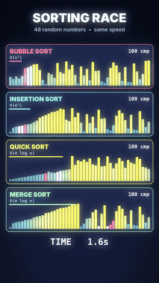
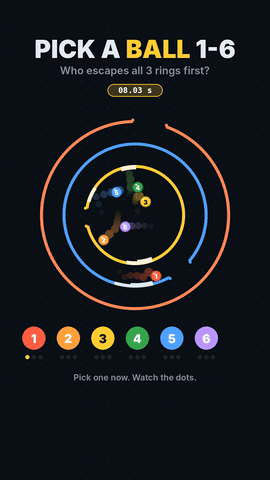
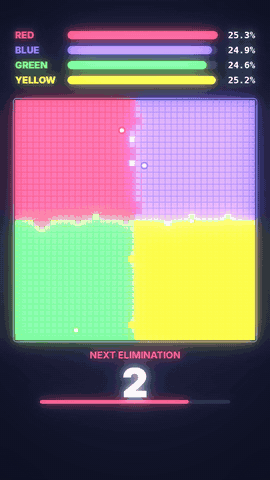
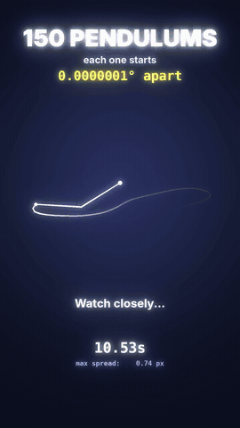
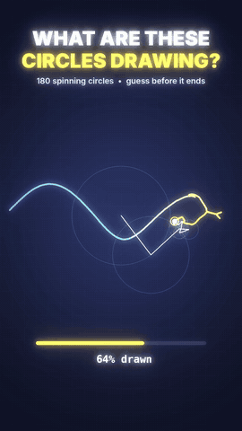
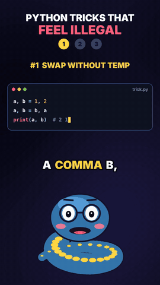
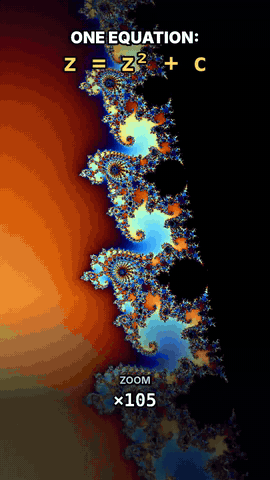
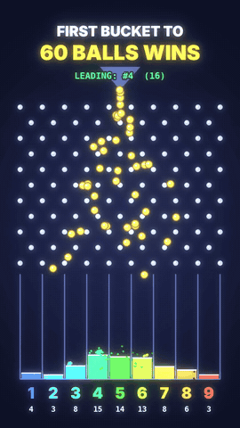
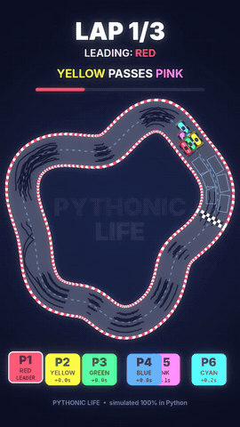
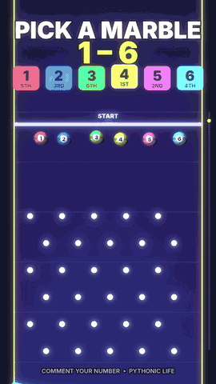

# 🐍 Pythonic Life — Shorts

Satisfying vertical animations for YouTube Shorts, generated **100% in Python**.
Every frame is drawn with NumPy, Pillow and OpenCV, and every sound is synthesized with NumPy. No video editor, no stock footage, no AI video models.

Code behind the **Pythonic Life** YouTube channel.

  

| **01 · Sorting Race** | **02 · Can It Escape?** | **03 · Color War** |
|:---:|:---:|:---:|
|  |  |  |
| <sub>4 sorting algorithms race on the same 48 numbers</sub> | <sub>A ball bounces through 12 spinning rings with one gap each</sub> | <sub>4 colors fight for territory; the smallest is eliminated every 7 s</sub> |
| **04 · Chaos Pendulums** | **05 · Fourier Mystery** | **06 · Talking Py** |
|  |  |  |
| <sub>150 double pendulums start 0.0000001° apart, then chaos takes over</sub> | <sub>180 rotating circles draw a mystery shape</sub> | <sub>A snake explains 3 Python tricks with lip-sync and code cards</sub> |
| **07 · Infinite Zoom** | **08 · Plinko Race** | **09 · Pick a Car** |
|  |  |  |
| <sub>A 1,000,000,000,000× Mandelbrot zoom</sub> | <sub>Pick a number 1-9: first bucket to 60 balls wins</sub> | <sub>6 cars, 3 laps, 1 photo finish</sub> |
| **10 · Pick a Marble** | &nbsp; | &nbsp; |
|  | &nbsp; | &nbsp; |
| <sub>6 marbles race down a course and the video loops</sub> | &nbsp; | &nbsp; |

## Quick start

```bash
git clone https://github.com/VALIJONY/pythonic-life-shorts.git
cd pythonic-life-shorts
pip install -r requirements.txt

# Linux (Ubuntu / Zorin / Debian): ffmpeg + fonts used by the renders
sudo apt install ffmpeg fonts-inter fonts-dejavu-core
```

Each script renders a 1080×1920 / 30 fps MP4 with audio into the current folder.

```bash
cd 01-sorting-race && python3 sort_race.py
cd 02-ring-escape  && python3 ring_escape.py 12     # seed = different run
cd 03-color-war    && python3 color_war.py 3        # seed = different winner
python3 color_war.py probe                          # list outcomes for 39 seeds
cd 04-chaos-pendulums && python3 chaos_pendulums.py
cd 05-fourier-mystery && python3 fourier_mystery.py
cd 06-talking-py && pip install piper-tts && python3 talking_py.py path/to/en-us-lessac-medium.onnx
cd 07-infinite-zoom && pip install numba && python3 infinite_zoom.py   # ~20-30 min on 2 cores
cd 08-plinko-race && python3 plinko_race.py 14                      # seed = different race; `probe` scans seeds
cd 09-car-race && python3 car_race.py 37                           # seed = different race; `probe` scans 60 seeds
cd 10-marble-race && python3 marble_race.py 1                      # seed = different race; `probe` scans 60 seeds
```

## The videos

### 01 — Sorting Race
Bubble, Insertion, Quick and Merge sort run in parallel at the same comparisons-per-frame speed.
Each comparison plays a tone pitched to the value being compared. The video ends with a results chart.

### 02 — Can It Escape?
A gravity-driven ball inside 12 counter-rotating rings. Each bounce plays the next note of a pentatonic melody.
Escaping a ring shatters it into particles. Change the seed and you get a completely different run.

### 03 — Color War
A pong-wars style territory battle with a battle-royale twist:
the smallest territory is eliminated every 7 seconds, survivors get an extra ball, and the final duel speeds up.
With seed `3`, RED wins by a single cell (473 vs 472).

### 04 — Chaos Pendulums
150 double pendulums, integrated with RK4 at 600 steps per second, start from the same position with
neighbours differing by 0.0000001°. For 12 seconds they move as one white pendulum. Then the butterfly effect
splits them into a rainbow. Audio: a tension pulse that speeds up before the split, then a cascade of chimes.

### 05 — Fourier Mystery
A closed outline (a python, built from a sinuous centreline with a head and forked tongue) is resampled to
2048 points and turned into a Fourier series with `np.fft.fft`. The 180 largest terms become a chain of rotating
circles whose tip redraws the shape. The melody follows the height of the pen. The bonus section shows the same
drawing with only 3, 12 and 50 circles.

### 06 — Talking Py
A cartoon snake mascot drawn entirely with Pillow (2× supersampled) explains "3 Python tricks that feel illegal".
The voice comes from [Piper](https://github.com/rhasspy/piper), an offline neural TTS
(voice `en-us-lessac-medium` from the Piper v0.0.2 release). Mouth opening follows the voice's RMS envelope,
captions highlight word by word, code cards type themselves with syntax highlighting,
and a lo-fi beat is ducked under the voice.

### 07 — Infinite Zoom
A trillion-times zoom into the Mandelbrot set (`z = z² + c`) at the "seahorse valley" point.
Each frame is computed in float64 with a parallel Numba kernel at 540×960 and upscaled, with smooth
(continuous) colouring through a cosine palette that slowly drifts. Iteration count grows with depth (up to ~2,800).
Milestones translate the zoom into real distances, the final frame circles a mini copy of the whole set,
and the ending flies back out to the start in one second.

### 08 — Plinko Race
A Galton board: ball–peg collisions are solved with NumPy (restitution 0.3, horizontal air drag, tiny jitter),
and balls are counted into 9 buckets. The first bucket to 60 balls wins. With these settings the buckets fill in
a bell-shaped distribution (middle ~25% each, edges ~3-5%). `python3 plinko_race.py probe` scans 40 seeds so you can pick
a close finish (seed 14: 60 vs 59 vs 57, and the winner is not the centre bucket).

### 09 — Pick a Car
A top-down racing simulation: 6 cars on a closed, never self-crossing circuit (a polar curve with 4 harmonics,
resampled by arc length). Each car brakes for upcoming corners (speed limit from curvature), gets slipstream
bonus behind another car, random boosts and an occasional spin-out. A light rubber-band catch-up keeps the pack
together, so the race stays close (this is a game-style simulation, not a physical model of real cars).
Passes use a sticky order (a car must be 18 px ahead) so lead changes are real, not flicker.
Engines are 6 sawtooth voices whose pitch follows each car's speed. `python3 car_race.py probe` scans 60 seeds;
seed 37 ends with YELLOW winning by 0.05 s after 17 passes in the top 3.

### 10 — Pick a Marble
A 4,000 px tall course with pegs, zig-zag ramps, rotating bars, a narrow funnel and bumpers. Six marbles are simulated
at 240 steps per second (marble-marble, peg, moving-segment and bumper collisions) and a camera follows the leader.
The video is built for retention: 18 s long, motion and the "pick 1-6" prompt from the very first frame, and the last
frame crossfades into the first so it loops. `python3 marble_race.py probe` scans 60 seeds for a close finish where the
winner was last at some point; seed 1: marble 3 wins by 0.13 s after being last place.

## How it works

```
simulation (NumPy)  ──►  frames (Pillow + OpenCV glow)  ──►  ffmpeg stdin pipe  ──►  H.264
        │
        └──►  events  ──►  synthesized audio (NumPy)  ──►  WAV  ──►  muxed AAC
```

- Physics and game logic run first. Each frame records state plus events (bounces, flips, eliminations).
- Rendering is a pure function of that state, so the same seed always produces the same video.
- Glow comes from blurring a downscaled frame and adding it back on top.
- Audio is built by placing short synthesized tones on a sample buffer at the exact event times.

## License

MIT. Use it, remix it, make your own Shorts. A shout-out to Pythonic Life is appreciated 🙌
